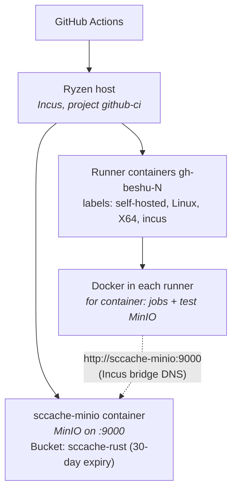
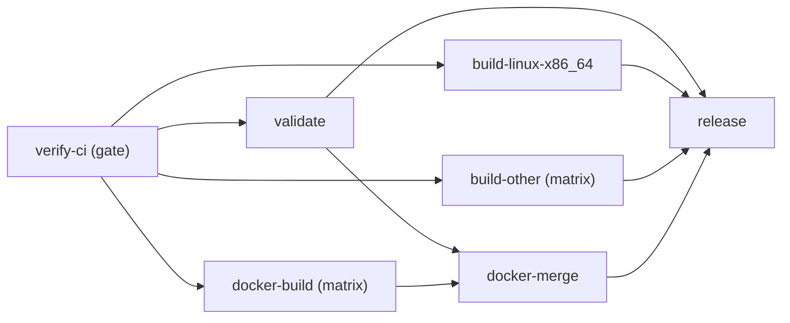

# CI Infrastructure

*Build, test, and deployment pipeline*

This document describes the CI infrastructure for DeltaGlider Proxy, the design decisions behind it, and how to reproduce or adapt this setup for other Rust projects.

> **Status (2026-10-26):** `ci.yml`, `test-all-nightly.yml`, `claude.yml` and `claude-code-review.yml` run on GitHub-hosted `ubuntu-latest` runners (4 vCPU, 16 GB RAM). The repo is public, so these runners have no minute cost. They still use the builder image as a `container:` job. Dependencies come from `Swatinem/rust-cache`: one Actions-cache entry per dependency set (`release`, `test`, `clippy`), restored at job start and saved only on `main` when `Cargo.lock` or the toolchain changes. (The self-hosted sccache MinIO is not reachable from GitHub. sccache's GitHub Actions cache backend was tried and dropped on 2026-10-01: it sends one cache request per object file, and GitHub answered most of them with 429 "rate limit exceeded", so every job recompiled the C and assembly objects of aws-lc and sqlcipher.) The reasons for the move: the homelab runner containers have a 5 GB memory limit, and the nightly `cargo test --all` was SIGKILLed at that limit; four runners were shared by CI and the nightly; and a public repo on self-hosted runners lets fork PRs run code on the homelab. Only `release.yml` and `prepare-release.yml` still use the self-hosted runners, through the `incus` label. The rest of this document describes the self-hosted setup.

## Architecture Overview



Each runner is an Incus system container with its own Docker daemon and its own disk, so `container:` jobs write `target/` straight to the host SSD. The sccache MinIO is a separate Incus container on the same bridge.

All CI jobs run inside a custom **builder image** (`ghcr.io/beshu-tech/deltaglider_proxy/builder:latest`) pulled as a `container:` job. The image is based on Ubuntu 24.04 with all tools pre-installed: Rust stable, Node.js 20, clippy, rustfmt, cargo-audit, cargo-sbom, sccache, xdelta3, Docker CLI, unzip, and the MinIO client (`mc`, built from the `pgsty/mc` fork's `mcli` release because dl.min.io stopped serving it).

## Why sccache on self-hosted runners

Measured on the self-hosted runners with a warm cache:

| Cache | Clippy | Tests | Pipeline |
|---|---|---|---|
| GitHub-hosted + rust-cache (baseline) | 46s | 2m30s | ~6m24s |
| Self-hosted + rust-cache | 1m59s | 3m18s | ~3m22s |
| **Self-hosted + sccache** | **27s** | **1m45s** | **~2m48s** |

rust-cache spent 57–86s per job restoring and saving its `target/` snapshot from GitHub's cache servers. sccache fetches individual compilation results inline from a MinIO on the same bridge, so the restore and save steps disappear.

The runner's work directory must be on the container's own disk, not on overlay2 (the Docker default for a job container's writable layer): Rust writes thousands of intermediate files, and overlay2 copy-on-write made Clippy 14x slower.

## Components

### 1. Builder Image

**Location:** `.github/builder/Dockerfile`
**Registry:** `ghcr.io/beshu-tech/deltaglider_proxy/builder:latest`
**Workflow:** `.github/workflows/builder-image.yml` (auto-rebuilds on push to `.github/builder/`)

The image is a plain Ubuntu 24.04 with every tool pre-installed. This means zero on-the-fly downloads during CI jobs.

**Included tools:**
- Rust stable (minimal profile: no docs, no man pages)
- rustfmt, clippy
- cargo-audit, cargo-sbom, sccache
- Node.js 20 + npm
- xdelta3
- Docker CLI (static binary, not the daemon)
- MinIO client (`mc` = pgsty/mc `mcli`)
- unzip (the Claude action's Bun bootstrap needs it)

**Size optimization:**
- `--profile minimal` for rustup (skips docs/man)
- Static Docker CLI binary (~50MB) instead of full apt package (~300MB)
- `rm -rf "$CARGO_HOME"/registry "$CARGO_HOME"/git` after installing cargo tools
- Total image size: ~1.5GB

**When to rebuild:** Whenever you update Rust toolchain version, add/remove cargo tools, or change system dependencies. Push changes to `.github/builder/` and the workflow auto-triggers. Takes ~8-9 minutes on GitHub-hosted runners.

### 2. Self-Hosted Runners (Incus containers)

**Host:** the Ryzen box, Incus project `github-ci`
**Runners:** `gh-beshu-N`, registered to the `beshu-tech` organization
**Labels:** `self-hosted, Linux, X64, incus` — workflows select them with `runs-on: incus`

Each runner container has the GitHub Actions runner as a systemd service, a Docker daemon for `container:` jobs, and a passwordless-`sudo` `runner` user. One runner runs one job at a time, and every container has its own disk, so concurrent jobs never share a work directory or a Docker store.

**Open-file limit (`nofile`) — REQUIRED, both host and workflow:**
An LXC container inherits a **low default `nofile` (~1024)** unless raised. The
integration job runs **~35 test binaries in one `cargo test` invocation**, each spawning
its own proxy + MinIO sockets, so the *aggregate* open-fd count easily crosses 1024 and
surfaces — non-deterministically, under load — as:

```
ConnectError("tcp open error", Os { code: 24, message: "Too many open files" })
```

It typically panics mid-seed in whichever test opens the most connections (historically
the old `recursive_delete_test`, which seeded 1100 objects), but the root cause is the shared,
under-sized fd table, not any single test. Two layers fix it (keep BOTH):

1. **Host side (the real fix).** On the Ryzen host, raise the LXC container's limit so
   everything inside inherits it. Run the idempotent helper as root on the host:
   ```
   sudo scripts/bump-runner-nofile.sh            # auto-detects LXC/Incus/LXD containers
   sudo scripts/bump-runner-nofile.sh ct1 ct2    # or name them explicitly
   ```
   It sets `lxc.prlimit.nofile` (or the Incus/LXD `limits.kernel.nofile` equivalent) and
   pins `LimitNOFILE` on the in-container `actions-runner` systemd unit. Equivalent manual
   steps:
   ```
   # /var/lib/lxc/<container>/config
   lxc.prlimit.nofile = 1048576
   # systemctl edit actions-runner   →   [Service]
   LimitNOFILE=1048576
   ```
   Restart the container afterwards (`lxc-stop && lxc-start`, or `incus restart`). Verify
   from a job step: `ulimit -Sn; ulimit -Hn; cat /proc/sys/fs/file-max`.

2. **Workflow side (belt-and-suspenders, self-documenting).** Every `container:` block in
   `ci.yml` sets `options: --ulimit nofile=1048576:1048576`. This makes the requirement
   visible to future readers and keeps the workflow portable to a fresh runner host that
   hasn't had the host-side bump applied yet. (It only takes effect up to the host's hard
   limit, so the host bump in #1 is still authoritative.)

Tests should also avoid unbounded N-way connection fan-out (cap seeding with a
`tokio::sync::Semaphore`) so a single test can't dominate the shared fd budget — but that
is hygiene, not a substitute for the limit bump.

### 3. sccache + Local MinIO

**Container:** `sccache-minio` (Incus project `github-ci`), MinIO as a systemd service on `:9000`
**Endpoint:** `http://sccache-minio:9000`
**Bucket:** `sccache-rust` with 30-day object expiration lifecycle rule

The endpoint is the container's short name. The Incus bridge's DNS answers it, and Docker job containers inherit that resolver from their runner, so it resolves inside `container:` jobs. A name that exists only in a runner's `/etc/hosts` does not: Docker does not copy the runner's `/etc/hosts` into the job container.

sccache is a Rust compilation cache that operates at the individual crate level. Unlike `Swatinem/rust-cache` (which uploads/downloads a bulk snapshot of `target/` from GitHub's remote cache servers), sccache:

1. Intercepts each `rustc` invocation via `RUSTC_WRAPPER=sccache`
2. Computes a hash of the compiler + flags + source files
3. Checks the local MinIO bucket for a cached result
4. On hit: returns the cached `.rlib` without invoking the compiler
5. On miss: compiles normally, then stores the result in MinIO

**Why sccache over Swatinem/rust-cache for self-hosted runners:**

| Dimension | Swatinem/rust-cache | sccache + local MinIO |
|---|---|---|
| Cache granularity | Entire `target/` snapshot | Per-crate compilation unit |
| Storage | GitHub Actions cache API (10GB cap) | Local MinIO (no cap) |
| Restore time | 57-86s (download from GitHub) | 0s (inline during build) |
| Save time | 1-5s (upload to GitHub) | 0s (inline during build) |
| Cross-job sharing | No (each job saves its own snapshot) | Yes (all jobs share one bucket) |
| Network latency | Cross-internet to GitHub | ~0ms (same host bridge) |

**What sccache cannot cache:** proc-macro crates, binary crates, crates with C library builds via `build.rs`. These are compiled fresh each run but are typically a small fraction of total build time.

**Environment variables** (set at workflow level in `release.yml`):

```yaml
env:
  RUSTC_WRAPPER: sccache
  CARGO_INCREMENTAL: "0"          # required by sccache
  SCCACHE_BUCKET: sccache-rust
  SCCACHE_ENDPOINT: http://sccache-minio:9000
  SCCACHE_REGION: auto
  SCCACHE_S3_USE_SSL: "false"
  AWS_ACCESS_KEY_ID: sccache
  AWS_SECRET_ACCESS_KEY: sccache-secret-key
```

Jobs that don't compile Rust, and jobs on GitHub-hosted runners, override `RUSTC_WRAPPER: ""`.

### 4. Test MinIO (Ephemeral)

Integration tests need an S3-compatible backend. A **separate, ephemeral** MinIO instance — the `pgsty/silo` build, a maintained MinIO fork with the same `MINIO_*` env and API (`minio/minio` left Docker Hub in September 2026) — is started per test job:

```yaml
- name: Start MinIO for tests
  run: |
    # Ephemeral MinIO for integration tests — NOT the sccache MinIO
    docker run -d --name minio-ci --network container:$(hostname) \
      -e MINIO_ROOT_USER=minioadmin \
      -e MINIO_ROOT_PASSWORD=minioadmin \
      pgsty/silo:RELEASE.2026-09-16T00-00-00Z server /data
```

The `--network container:$(hostname)` flag shares the job container's network namespace with the MinIO container, making it reachable at `localhost:9000` from the job. This is necessary because GitHub Actions `container:` jobs run inside Docker, and `services:` cannot pass CMD arguments (MinIO needs `server /data`).

**This MinIO is completely separate from the sccache MinIO.** Different container, different credentials, different lifecycle. It is destroyed at the end of every test job.

## Workflow Files

| File | Purpose | Runs on |
|---|---|---|
| `ci.yml` | fmt, clippy, tests, audit, docs, lint | GitHub-hosted (`ubuntu-latest`) |
| `release.yml` | validate, build, Docker push, GitHub Release | `incus` (validate, x86_64 build, release), `homelab` (amd64 Docker image), Blacksmith/GitHub-hosted (other targets, arm64 Docker image, merge) |
| `prepare-release.yml` | Version bump and release PR | `incus` |
| `builder-image.yml` | Rebuild the CI builder image | GitHub-hosted (`ubuntu-latest`) |

### Release Pipeline (`release.yml`)



- `build-linux-x86_64`: `incus` runner with sccache (fastest)
- `build-other` (ARM Linux, macOS): GitHub-hosted/Blacksmith with `Swatinem/rust-cache` (can't reach local MinIO)
- `docker-build`: amd64 on `homelab` (`vars.HOMELAB_RUNS_ON`), arm64 on Blacksmith; BuildKit layer cache in GHCR, no sccache

## How to Reproduce This Setup

### Prerequisites

1. A server with a fast SSD (NVMe preferred) and decent CPU (8+ threads)
2. Incus (or LXD) with a managed bridge network, so containers resolve each other by name
3. A GitHub organization or repository with self-hosted runner access

### Step 1: Create the Builder Image

1. Create `.github/builder/Dockerfile` with your project's tool requirements
2. Create `.github/workflows/builder-image.yml` to auto-build on push
3. Push and wait for the image to appear on GHCR
4. Make the GHCR package public (Settings > Packages > Visibility)

**Tips:**
- Use `--profile minimal` for rustup to save ~500MB
- Use static Docker CLI binary instead of the apt package
- Clean `$CARGO_HOME/registry` and `$CARGO_HOME/git` after installing cargo tools
- Run a verification step at the end to catch missing tools early

### Step 2: Create the Runner Containers

One Incus container per concurrent job, each with Docker installed and the Actions runner registered as a service:

```bash
incus launch images:ubuntu/24.04 gh-runner-1 --project github-ci \
  -c security.nesting=true -c limits.cpu=4 -c limits.memory=8GB
# inside: install docker.io, create user `runner` in the docker group, then
sudo -u runner ./config.sh --url https://github.com/<org> --token <token> \
  --name gh-runner-1 --labels incus --unattended
sudo ./svc.sh install runner && sudo ./svc.sh start
```

`security.nesting=true` lets Docker run inside the container. Raise `nofile` as described above before the first integration run.

**Recommended minimums per runner for a Rust CI workload:**

| Resource | Minimum | Recommended |
|---|---|---|
| CPU | 4 cores | 8+ cores |
| RAM | 8 GB | 16 GB |
| Disk | 50 GB | 80+ GB |

### Step 3: Deploy the sccache MinIO

A persistent MinIO in its own container on the same bridge, with distinctive credentials:

```bash
incus launch images:ubuntu/24.04 sccache-minio --project github-ci
# inside: install the MinIO server binary as a systemd service:
#   MINIO_ROOT_USER=sccache MINIO_ROOT_PASSWORD=sccache-secret-key
#   ExecStart=/usr/local/bin/minio server /data --console-address :9001
mc alias set local http://localhost:9000 sccache sccache-secret-key
mc mb --ignore-existing local/sccache-rust
mc ilm rule add local/sccache-rust --expire-days 30
```

**Keep it distinct.** Use its own container, distinctive credentials (not `minioadmin`), and a clear name. You will likely have other MinIO instances (test, application). Making them visually and operationally distinct prevents accidents.

### Step 4: Configure Workflows

Add the sccache environment variables at the workflow level (see section 3) and select the runners with `runs-on: incus`. Override `RUSTC_WRAPPER: ""` for jobs that don't compile and for jobs on GitHub-hosted runners, which can't reach the local MinIO.

## Troubleshooting

### "No space left on device" during image pull

The runner container's disk is too small. Grow its root disk:
```bash
incus config device set gh-beshu-1 root size=80GB --project github-ci
```

### sccache misses on every build

Check that the MinIO endpoint is reachable from inside the `container:` job:
```bash
# From inside a CI step
curl -s http://sccache-minio:9000/minio/health/ready
sccache --show-stats
```

If the name does not resolve, the job container is not using the Incus bridge DNS; if it resolves but the connection fails, check that `sccache-minio` still has its IPv4 address (`incus list --project github-ci`).

### Test MinIO unreachable at localhost:9000

The ephemeral test MinIO must share the job container's network namespace:
```bash
docker run -d --network container:$(hostname) pgsty/silo:RELEASE.2026-09-16T00-00-00Z server /data
```

Do **not** use `--network host` — that puts MinIO on the runner container's network, not the job's.

## Alternatives Considered

### GitHub Hosted Runners

- Free for public repos, zero maintenance
- Slower CPUs, remote cache, no infra ownership
- Good default; switch to self-hosted only when speed matters

### Blacksmith (blacksmith.sh)

- Gaming-grade CPUs (Passmark ~4479 single-thread), 4x faster cache
- Drop-in replacement: just change `runs-on:` label
- $0.004/min, 3000 free min/month
- Best option if you don't want to maintain infrastructure

### Swatinem/rust-cache (without sccache)

- Simple: one `uses:` line in the workflow
- Works on any runner (hosted or self-hosted)
- Bottleneck: bulk upload/download of `target/` snapshot over the internet
- Keep it for jobs on GitHub-hosted runners that can't reach local MinIO

## File Reference

```
.github/
  builder/
    Dockerfile              # CI builder image definition
  workflows/
    builder-image.yml       # Auto-rebuild builder image
    ci.yml                  # CI pipeline (fmt, clippy, test, audit)
    prepare-release.yml     # Release PR preparation
    release.yml             # Release pipeline (build, Docker, GitHub Release)
scripts/
  bump-runner-nofile.sh     # Raise nofile on the runner containers (run on the host)
```

## CLA signing

First-time contributors must sign the CLA. On any open PR the `cla-check` flags,
post a comment containing exactly:

```
I have read the CLA Document and I hereby sign the CLA
```

The CLA Assistant records the signature into `.cla-signatures/signatures.json`
from the commenter's verified GitHub identity. The bot allowlist
(`.github/workflows/cla.yml`) skips Dependabot / Renovate / github-actions.
